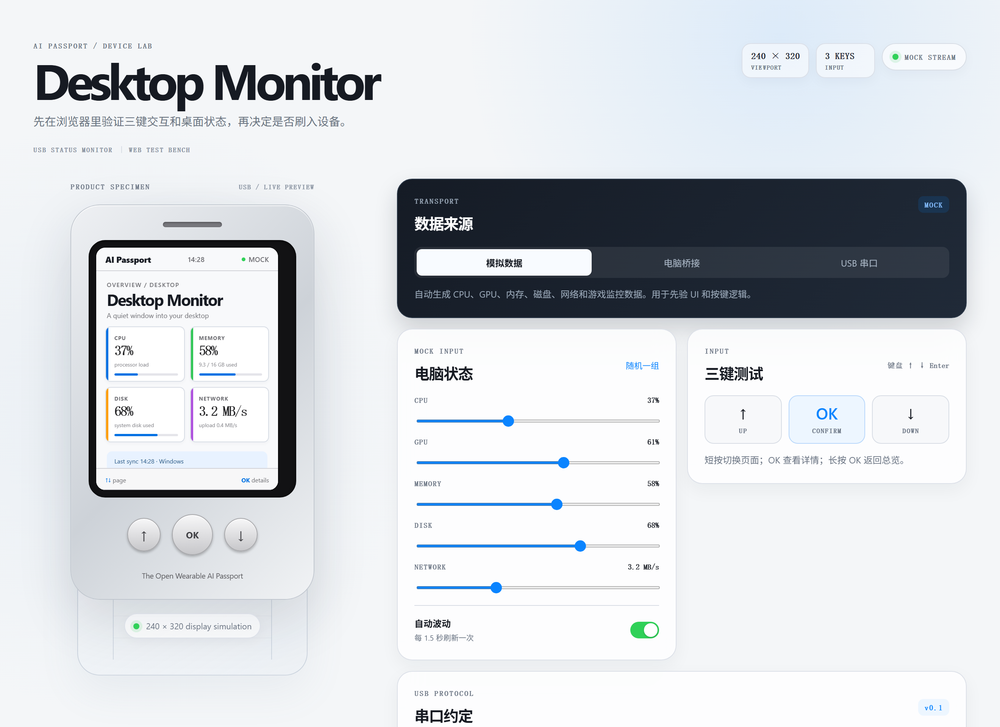

English | [简体中文](README.zh_CN.md)

# AI Passport Playground

Independent experiments for the FoloToy AI Passport, each in its own project directory.
Based on [FoloToy/ai-passport](https://github.com/FoloToy/ai-passport), under the MIT license. Original BSP and pixel mascot attribution is retained in [LICENSE](LICENSE).

- [Pocket Universe / Orbital Post](projects/orbital-post/README.md): a Chinese-first four-tool collection with interstellar letters, mood signs, randomizers, and a reaction game.
- [Desktop Monitor](projects/desktop-monitor/README.md): the previous USB computer monitor, preserved with its Windows bridge and browser simulator.

Both target ESP32-C3, ESP-IDF 5.5.3 and a 240x320 display. Each directory is a standalone ESP-IDF project with its own BSP, dependency lock and partition table. They are alternative applications, not simultaneous apps.

Never erase flash or overwrite the protected `cardid` partition at `0x356000`. Device backups, identities, credentials and local logs are intentionally excluded. Hardware validation is distinct from compilation; see each project's limitations.

## Preview & Live Demo

**Desktop Monitor** includes a browser-based `240 × 320` display simulator with three-key (`↑` / `OK` / `↓`) interactive controls, mock telemetry sliders, and transport mode switching (`Mock`, `Computer Bridge`, `USB Serial`) for verifying UI and input flow before flashing:

- **Live Demo (GitHub Pages)**: [https://1beyond1.github.io/ai-passport-playground/](https://1beyond1.github.io/ai-passport-playground/)
- **Enable Pages Deployment**: In repository **Settings → Pages → Build and deployment → Source**, select **GitHub Actions**. `.github/workflows/pages.yml` automatically deploys `projects/desktop-monitor/tools/simulator/` on pushes to `main`.
- **Browser Loopback & Web Serial Notes**:
  - **Computer Bridge (`http://127.0.0.1:8765/stream`)**: Works from the HTTPS GitHub Pages demo in Chrome/Edge (loopback `127.0.0.1` is treated as a trustworthy origin, and the bridge returns CORS / Private Network Access headers). Firefox or Safari may block HTTP loopback requests from an HTTPS page as mixed content; in that case, serve `tools/simulator/` locally via `python -m http.server 4173 --directory projects/desktop-monitor/tools/simulator`.
  - **Web Serial**: Supported only in Chrome/Edge over **HTTPS** (including GitHub Pages) or `localhost`, and intended only for serial ports that emit `PCSTAT` directly (do not compete with `desktop_bridge.py` for the same COM port).

## Automated Checks (CI)

`.github/workflows/ci.yml` runs on pushes and pull requests to `main`:
- C11 state machine & parser unit tests (`test_orbit_state.c`, `test_pocket_state.c`, `test_desktop_state.c`)
- Python bridge syntax checks (`py_compile`) and unit tests (`unittest`)
- Simulator JavaScript syntax checks (`node --check`) and `PCSTAT` parser tests (`node --test`)
