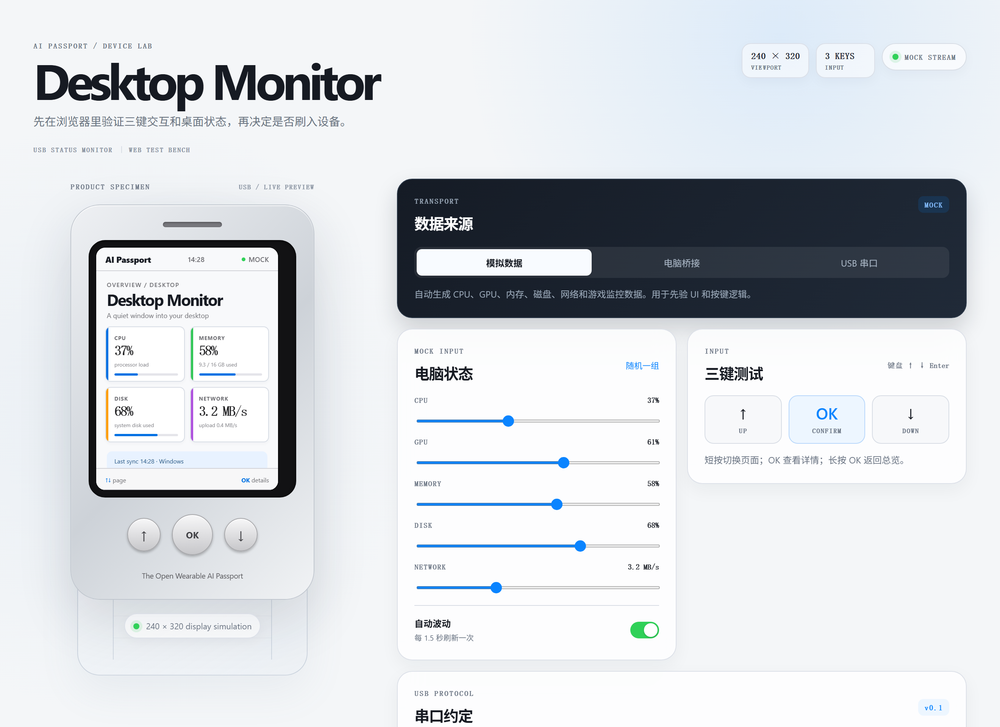

[English](README.md) | 简体中文

# AI Passport Playground

FoloToy AI Passport 独立实验合集，每个项目放在自己的文件夹。
基于 [FoloToy/ai-passport](https://github.com/FoloToy/ai-passport)，遵循 MIT 许可。[LICENSE](LICENSE) 保留原始 BSP 与像素角色的作者声明。

- [小宇宙 / 轨道邮局](projects/orbital-post/README.zh_CN.md)：中文四功能合集，包含星际来信、心情挂牌、随机器和反应测试。
- [电脑监控](projects/desktop-monitor/README.zh_CN.md)：保留之前的 USB 监控程序、Windows 桥接和浏览器模拟器。

两个项目均使用 ESP32-C3、ESP-IDF 5.5.3 和 240x320 屏幕。各目录都是独立 ESP-IDF 项目，包含 BSP、依赖锁文件和分区表；两者是替代应用，不能同时运行。

不要擦除 Flash，也不要覆盖 `0x356000` 的受保护 `cardid` 分区。仓库不含设备备份、身份数据、凭据和本机日志。编译成功不等于硬件验证，使用限制见各项目说明。

## 界面预览

**电脑监控（Desktop Monitor）**提供可在浏览器直接运行的 `240 × 320` 网页模拟器，支持三键（`↑` / `OK` / `↓`）交互测试、模拟数据滑块调节以及数据源切换（模拟数据 / 电脑桥接 / USB 串口），便于在刷入硬件前验证页面布局与按键逻辑：

