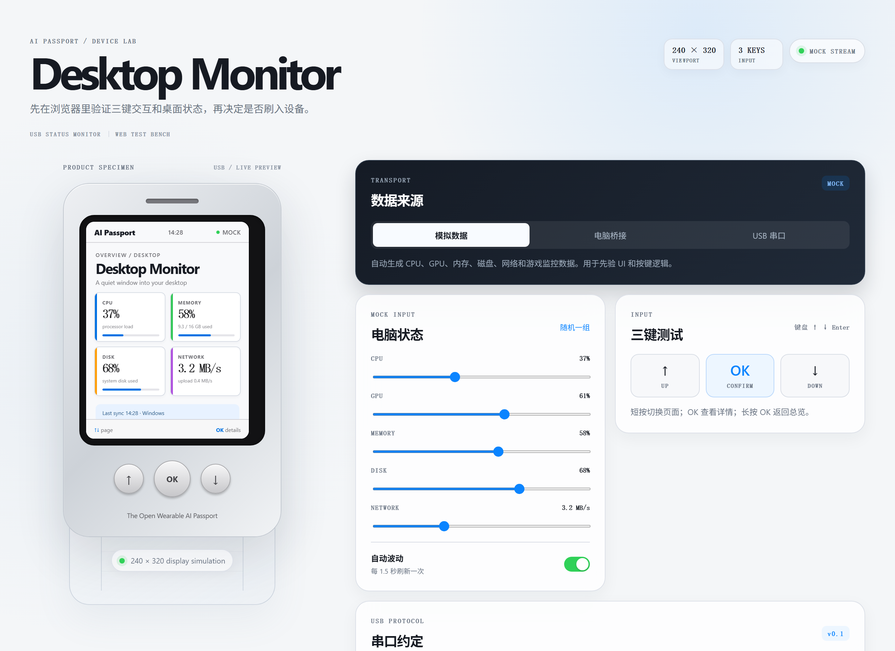

English | [简体中文](README.zh_CN.md)

# Desktop Monitor (preserved snapshot)

The previous USB telemetry application, preserved before Orbital Post. Build with ESP-IDF 5.5.3 using `idf.py build` in this directory. Do not erase flash or change the protected `cardid` partition.

Run the bridge on Windows (or Linux/macOS):

```sh
python -m pip install -r tools/requirements.txt
python tools/desktop_bridge.py --port auto
```

Or double-click `tools/start_bridge.bat` on Windows to check/install dependencies and start `--port auto` with the local SSE stream automatically.

- `--port auto` (default) scans connected USB ports for Espressif USB Serial/JTAG (VID `0x303A`) and automatically rescans/reconnects after unplugging or device resets.
- Explicit ports remain fully supported (`--port COM3`, `--port /dev/ttyACM0`), and `--http-only` runs only the local browser SSE stream without requiring a connected ESP32.
- The bridge serves live simulator data at `http://127.0.0.1:8765/stream` (and `/health`) and appends backward-compatible capacity fields (`mem_used_gb`, `mem_total_gb`, `disk_used_gb`, `disk_total_gb`) to `PCSTAT`. The web simulator renders real RAM/disk capacities (and gracefully degrades on legacy frames without `*_gb` fields), while the preserved ESP32 firmware parser (`desktop_state.c`) safely ignores unknown keys and stays under its 256-byte line limit.
- CPU temperature requires a supported sensor source such as LibreHardwareMonitor; NVIDIA telemetry uses `nvidia-smi`. Display Hz is not game FPS.

This is an archived firmware snapshot, not a polished release. On the device firmware itself, secondary memory/storage detail slots remain hard-coded placeholders; only fields parsed by `desktop_state.c` are live on hardware, whereas the web simulator displays live RAM/disk GB when supplied by `desktop_bridge.py`. Preserving this snapshot does not certify firmware placeholders as real telemetry. Local device firmware backups are intentionally not published.

## Live Demo & Simulator Preview

- **Online Simulator (GitHub Pages)**: [https://1beyond1.github.io/ai-passport-playground/](https://1beyond1.github.io/ai-passport-playground/)
- **Enable Pages**: Configure **Settings → Pages → Build and deployment → Source: GitHub Actions** (deployed by `.github/workflows/pages.yml`).
- **Browser Notes**: Chrome/Edge can connect from the HTTPS Pages demo to local `http://127.0.0.1:8765/stream` and support Web Serial on HTTPS/`localhost`. If Firefox/Safari blocks HTTPS-to-loopback HTTP requests, run the simulator locally (`python -m http.server 4173 --directory tools/simulator`). See [simulator instructions](tools/simulator/README.md).



*Browser-based `240 × 320` display simulation with three-key (`↑` / `OK` / `↓`) input testing and mock telemetry controls (see [simulator instructions](tools/simulator/README.md)).*

## Logic & Protocol Tests

From `projects/desktop-monitor`:

```sh
cc -std=c11 -D_POSIX_C_SOURCE=200809L -Wall -Wextra -Werror -Imain tests/test_desktop_state.c main/desktop_state.c -o test_desktop_state
./test_desktop_state
python -m py_compile tools/desktop_bridge.py tools/tests/test_desktop_bridge.py
python -m unittest discover -s tools/tests -p "test_*.py" -v
node --check tools/simulator/pcstat.js && node --check tools/simulator/app.js
node --test tools/tests/test_simulator_pcstat.test.js
```
