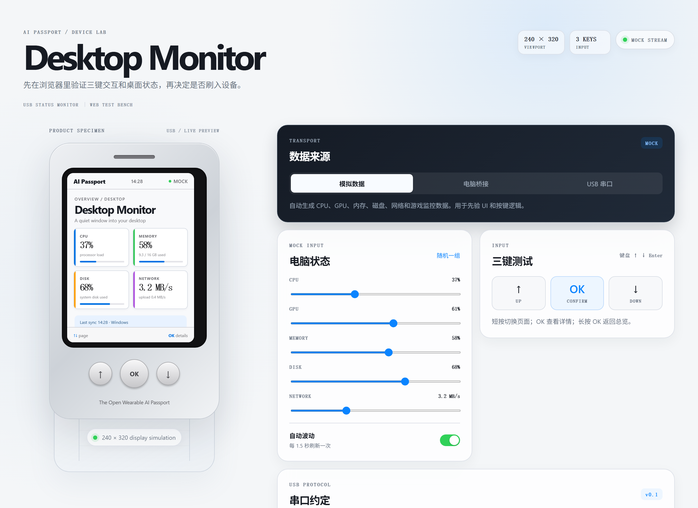

[English](README.md) | 简体中文

# 电脑监控（保留快照）

开发轨道邮局前的 USB 遥测应用。在本目录用 ESP-IDF 5.5.3 执行 `idf.py build` 编译。不要擦除 Flash 或修改受保护的 `cardid` 分区。

在 Windows 启动桥接：

```sh
python -m pip install psutil pyserial
python tools/desktop_bridge.py --port COM3
```

端口以实际设备为准。桥接通过 `http://127.0.0.1:8765/stream` 提供模拟器实时数据，详见[模拟器说明](tools/simulator/README.zh_CN.md)。CPU 温度需要 LibreHardwareMonitor 等支持的传感器来源；NVIDIA 数据使用 `nvidia-smi`。屏幕刷新率 Hz 不是游戏 FPS。

这是归档原型，不是完善发行版。部分次要内存／存储字段仍为写死的占位值；只有 PCSTAT 提供的字段才是实时数据。模拟器和固件可能有差异。保存快照不代表把占位值认证为真实遥测。本地设备固件备份不公开上传。

## 网页模拟器预览



*浏览器端 `240 × 320` 屏幕仿真、三键（`↑` / `OK` / `↓`）交互测试与模拟数据控制面板（详见[模拟器说明](tools/simulator/README.zh_CN.md)）。*
